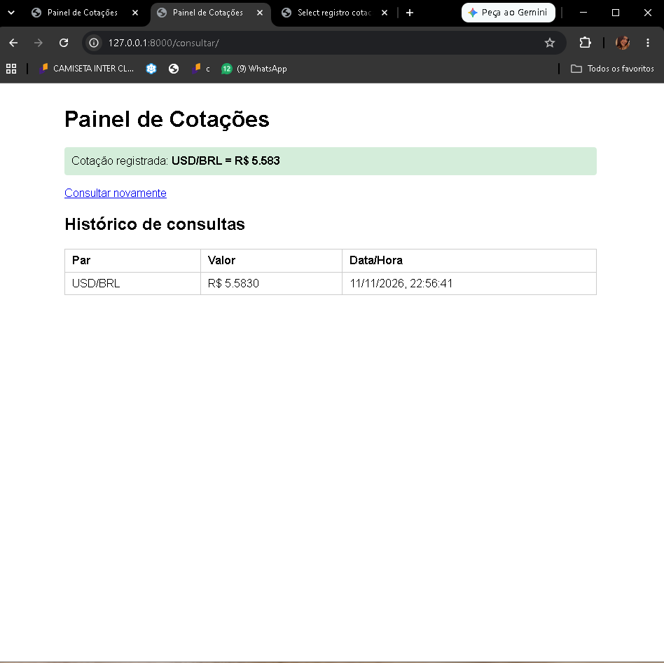
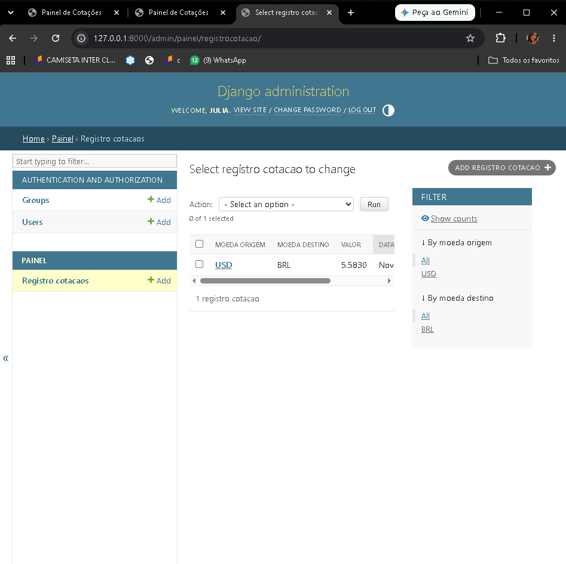

# Painel de Cotações — Projeto 4

Painel Django que consulta a cotação USD/BRL na AwesomeAPI,
guarda o histórico no banco e o exibe com fetch().

## Funcionalidades
- /consultar/ busca a cotação e salva um registro
- Tratamento de falhas de rede no servidor e no navegador
- /api/historico/ (JSON, mais recente primeiro)
- Consulta múltipla de USD, EUR e BTC em uma única requisição
- Gráfico de variação das cotações com Chart.js, permitindo selecionar a moeda

## Como rodar
1. python -m venv venv e ative o ambiente
2. pip install -r requirements.txt
3. python manage.py migrate
4. python manage.py runserver

## Variáveis de ambiente (opcional)
- COTACAO_URL: troca a URL da API externa

## Prints

### Painel de Cotações

### Django Admin

## Etapas de desenvolvimento

O projeto foi desenvolvido utilizando Python, Django e Django REST Framework, seguindo as orientações do professor.

Primeiro, criei o projeto Django e configuramos o ambiente virtual, instalando as bibliotecas necessárias. Depois, criei o aplicativo painel e configuramos a URL da API externa.

Em seguida, desenvolvi o modelo RegistroCotacao para armazenar os valores consultados, a moeda de origem, a moeda de destino e a data da consulta. Também configurei o Django Admin para visualizar os registros.

Depois, criei o Serializer e as Views, responsáveis por consultar a AwesomeAPI, salvar as cotações e disponibilizar o histórico em JSON.

Por último, configurei as URLs e desenvi a página HTML, utilizando JavaScript e fetch() para apresentar o histórico de consultas.

## Funcionamento do sistema

Quando o usuário acessa a página /consultar/, o Django realiza uma requisição à AwesomeAPI para obter a cotação do dólar em reais.

Se a consulta funcionar, o valor é salvo no banco de dados e uma mensagem de sucesso aparece na página.

O histórico é disponibilizado pela rota /api/historico/ e carregado automaticamente pelo JavaScript, utilizando fetch().

Os registros aparecem organizados do mais recente para o mais antigo.

O sistema também possui tratamento de erros. Caso a API externa esteja indisponível ou ocorra uma falha de conexão, uma mensagem amigável é apresentada ao usuário.

## Dificuldades encontradas

Durante o desenvolvimento, encontrei um problema na instalação das bibliotecas. Mesmo após a instalação inicial do Django, o Python não conseguia localizar o módulo.

Para resolver, utilizei o comando python -m pip install django djangorestframework requests, garantindo que as bibliotecas fossem instaladas no ambiente Python utilizado pelo projeto.

Também tive uma dificuldade durante os testes de falha de rede no navegador. A primeira regra de bloqueio não funcionou, então configurei o endereço completo da API na ferramenta Request conditions do Chrome.

Depois dessa correção, consegui confirmar que o JavaScript apresentava a mensagem de erro esperada.

## Testes realizados

Realizei os sete testes manuais solicitados no guia, verificando a consulta da cotação, o histórico, a API em JSON, os registros no Django Admin e o tratamento de erros.

Também executei os oito testes automatizados com o comando python manage.py test.

Todos os oito testes automatizados passaram com sucesso, apresentando o resultado OK no terminal.

## Autor
Júlia Ramos Dos Santos — IESB 2026
